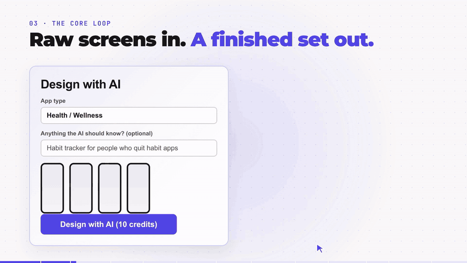
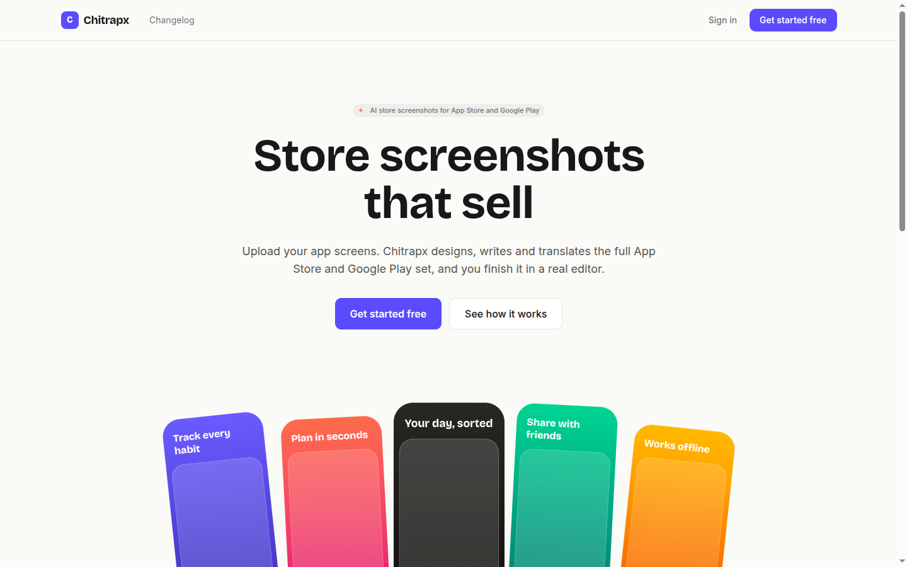
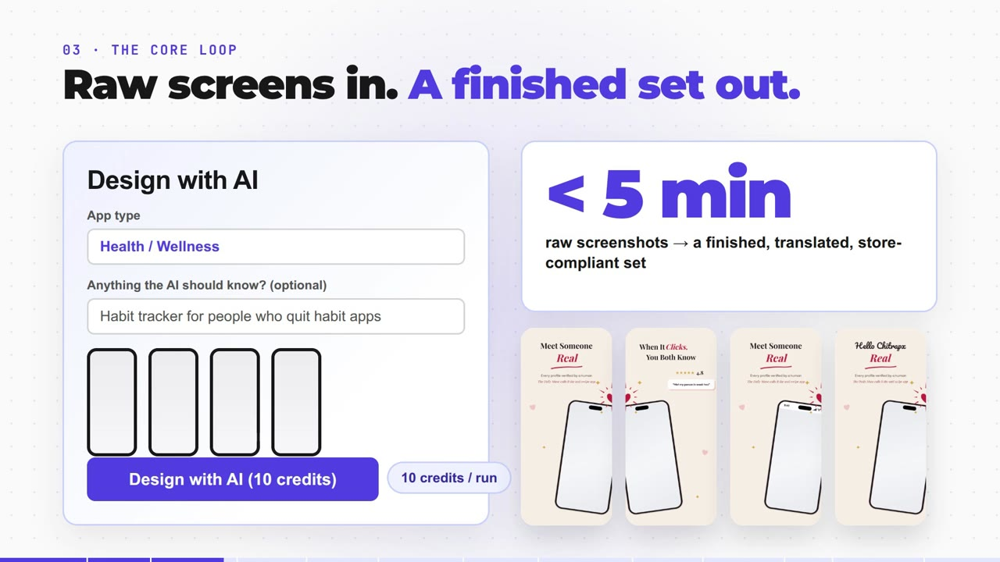
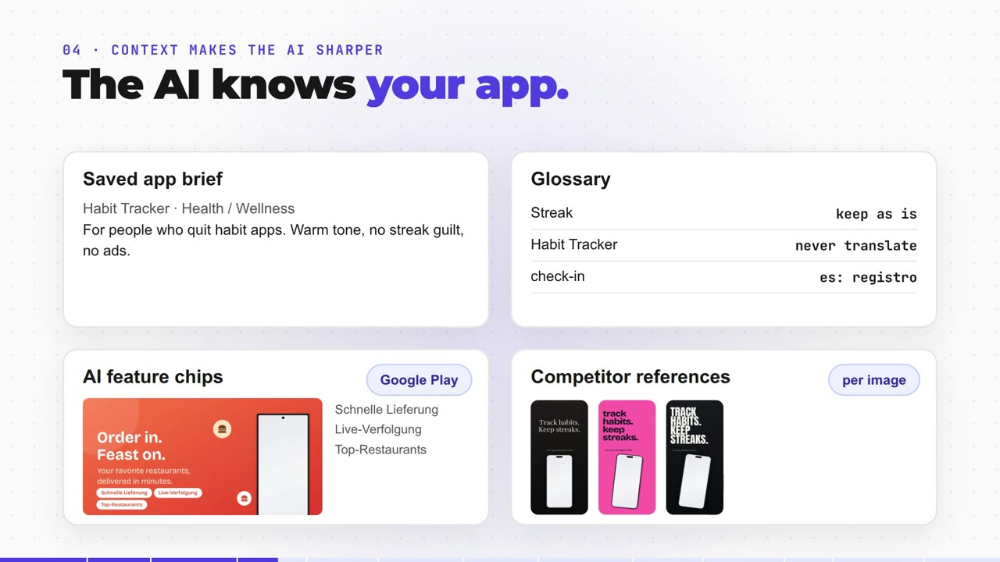
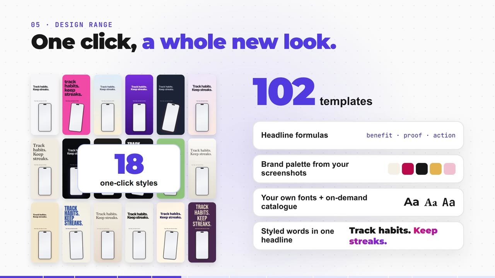
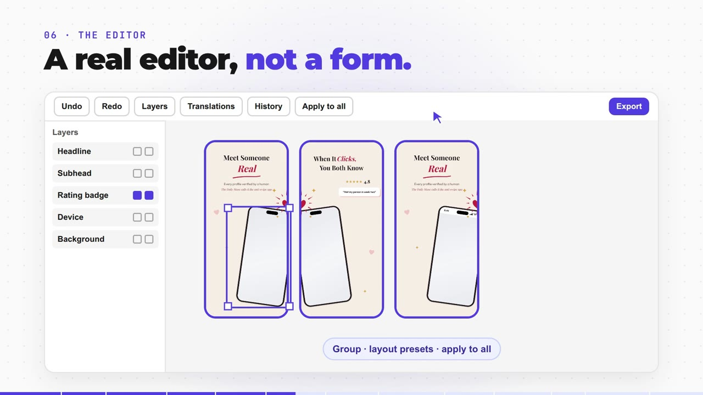
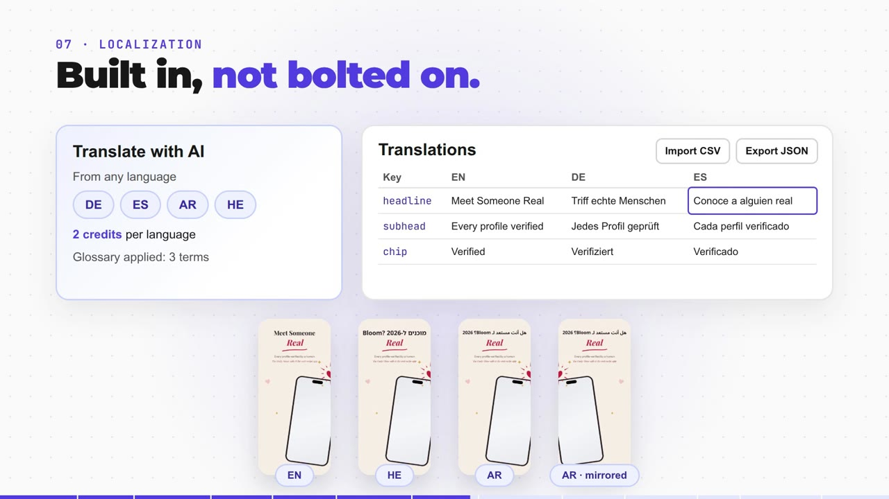
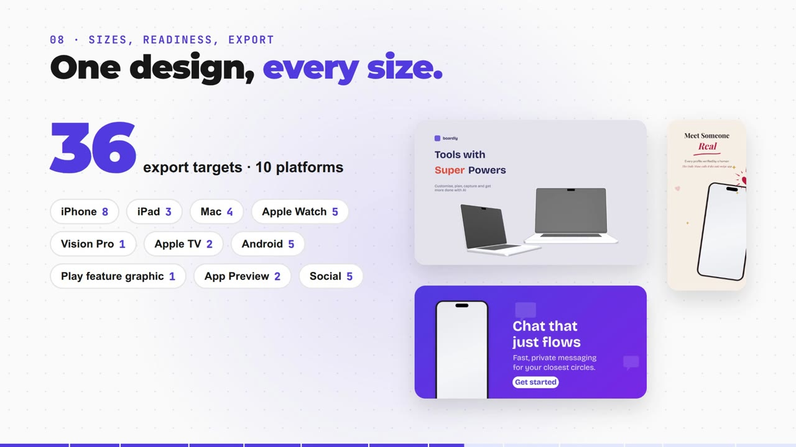
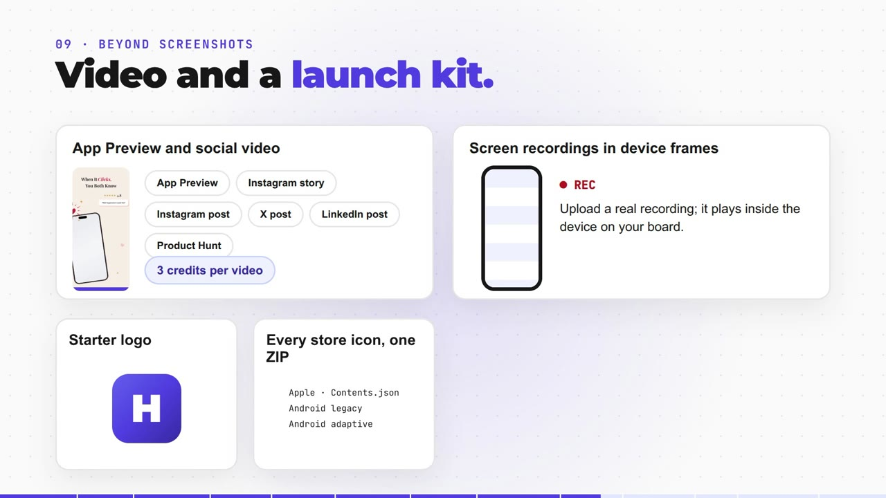
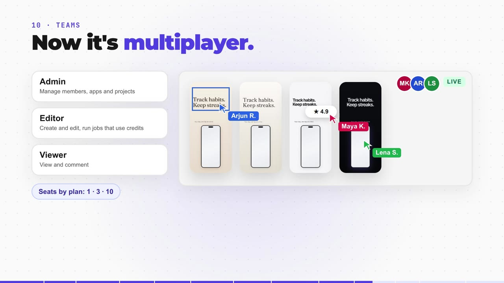

<div align="center">

# Chitrapx: AI App Store and Google Play Screenshot Generator

**Store screenshots that sell.** Upload your raw app screens. Chitrapx designs, writes and translates the full App Store and Google Play screenshot set, and you finish it in a real editor. Then export every size the stores ask for.

[](https://nextjs.org)
[](https://react.dev)
[](https://www.typescriptlang.org)
[](https://supabase.com)
[](LICENSE)
[](https://playwright.dev)



[Features](#features) · [Screenshots](#screenshots) · [How it works](#how-it-works) · [Local setup](#local-setup) · [Deploy](#deploy) · [FAQ](#faq)

</div>

---

## Why Chitrapx?

You never make just one screenshot set. You need iPhone and iPad, Android phones and tablets, a Google Play feature graphic, App Preview videos, and all of them again in every language you ship. In a design tool that takes days of repetitive work.

Chitrapx is an **AI screenshot generator for mobile apps** that cuts this down to minutes:

- **Under 5 minutes** from raw screens to a finished, translated set that meets store requirements
- **102 templates** and **18 one-click styles**
- **36 export targets** across **10 platforms**
- **AI localization** with RTL mirroring for Arabic and Hebrew



## Features

| | |
|---|---|
| **AI design** | Upload raw screens, pick the app type, and get a complete designed set: headlines, layout, device frames and colors. |
| **App context** | A saved app brief, a glossary (keep as is / never translate / fixed translations), AI feature chips and competitor reference images make every run match your app. |
| **Real editor** | Layers, groups, undo and redo, version history, layout presets, "apply to all", rich text with styled words, your own fonts plus a catalogue loaded on demand. |
| **Localization** | Translate with AI into any language, edit in a translations table, import CSV and export JSON. RTL layouts mirror automatically. |
| **Every store size** | iPhone, iPad, Mac, Apple Watch, Apple TV, Vision Pro, Android, Google Play feature graphic, App Preview and social sizes, with checks against store requirements. |
| **Launch kit** | App Preview and social videos, screen recordings inside device frames, a starter logo, every store icon in one ZIP, device mockups and collages. |
| **Teams** | Workspaces with Admin, Editor and Viewer roles, live presence, comments and share links. |
| **Community** | Publish a project as a template and start from what others made. |

## Screenshots

<table>
  <tr>
    <td></td>
    <td></td>
  </tr>
  <tr>
    <td align="center"><b>Raw screens in, finished set out</b></td>
    <td align="center"><b>The AI knows your app</b></td>
  </tr>
  <tr>
    <td></td>
    <td></td>
  </tr>
  <tr>
    <td align="center"><b>102 templates, 18 one-click styles</b></td>
    <td align="center"><b>A real editor, not a form</b></td>
  </tr>
  <tr>
    <td></td>
    <td></td>
  </tr>
  <tr>
    <td align="center"><b>Localization built in</b></td>
    <td align="center"><b>One design, every size</b></td>
  </tr>
  <tr>
    <td></td>
    <td></td>
  </tr>
  <tr>
    <td align="center"><b>Video and a launch kit</b></td>
    <td align="center"><b>Multiplayer teams</b></td>
  </tr>
</table>

## How it works

1. **Upload** raw screens, or drop in a whole folder.
2. **Design with AI.** Chitrapx analyses every screen, writes headlines from proven formulas (benefit, proof, action), picks a brand palette from your screenshots and lays out the set.
3. **Finish in the editor.** Change anything, try one of 18 styles, translate.
4. **Export** every size the stores need, or the full launch kit.

## Tech stack

- **Web:** Next.js 16 (App Router), React 19, TypeScript
- **Data and auth:** Supabase Postgres with row-level security, Drizzle ORM, Supabase Auth (magic link, Google, GitHub)
- **Jobs:** pg-boss worker for AI, exports and video
- **Rendering:** a shared React board renderer; Playwright Chromium for pixel-exact exports, checked against golden images
- **AI:** Google Gemini
- **Storage:** any S3-compatible service (AWS S3, Cloudflare R2, MinIO)
- **Billing:** Razorpay with plans, credits and multiple currencies

## Repository layout

```
apps/web           Next.js app: landing, dashboard, editor, admin, API routes
apps/worker        pg-boss job runner: AI, exports, video, icons
packages/db        Drizzle schema, RLS, credits, plans, onboarding, template seed
packages/document  document model, store size targets, retargeting, export plan
packages/renderer  board renderer (ported from open-screenshot-generator, see NOTICES.md)
packages/assets    bundled template layouts and golden reference renders
packages/storage   S3 helpers
```

## Local setup

Requires Node 24, pnpm 9, Docker (for MinIO) and a Supabase project (Postgres and Auth).

```bash
pnpm i
pnpm storage:up            # MinIO (S3) in Docker on :9000, console on :9001
pnpm storage:setup         # buckets, CORS, lifecycle rules (idempotent)
cp .env.example .env       # then fill in DATABASE_URL and the three Supabase keys from your project dashboard
pnpm db:migrate
pnpm db:seed               # loads the bundled templates
pnpm --filter @chitrapx/worker exec playwright install chromium   # for exports
pnpm dev                   # web on http://localhost:3000 + worker
```

Magic-link emails land in Mailpit at http://127.0.0.1:54324.

## Checks

```bash
pnpm typecheck && pnpm lint && pnpm test
pnpm --filter @chitrapx/worker test:e2e      # with `pnpm dev` running: real exports + golden images
UPDATE_GOLDEN=1 pnpm --filter @chitrapx/worker test:e2e   # after an intended visual change
```

## Deploy

Three pieces, all reading the same environment variables (see `.env.example`).

0. **Object storage** (AWS S3, Cloudflare R2 or any S3-compatible service)
   - Set `S3_*` (see `.env.example`) on web and worker, then run `WEB_ORIGIN=<web origin> pnpm storage:setup` once.
   - It creates both buckets, CORS for the web origin, a 1-day rule for `staging/` uploads and a 30-day rule for exports.
1. **Supabase** (cloud project)
   - Run migrations: `DATABASE_URL=<session pooler URL> pnpm db:migrate`.
   - Templates: `DATABASE_URL=... pnpm db:seed` after each release that changes `packages/assets/templates`.
   - Auth: set Site URL to the web origin, add `<origin>/auth/callback` to redirect URLs, enable the Google and GitHub providers.
2. **Web** (Vercel): project root `apps/web`, install command `pnpm install`, env `DATABASE_URL` (transaction pooler URL), `NEXT_PUBLIC_SUPABASE_URL`, `NEXT_PUBLIC_SUPABASE_ANON_KEY`, `SUPABASE_SERVICE_ROLE_KEY`, `RENDER_SECRET`, `S3_*`. Leave `ENABLE_DEV_TOOLS` unset.
3. **Worker** (Fly.io, Railway or any container host): `docker build -f apps/worker/Dockerfile .`, env `DATABASE_URL` (session pooler or direct URL, since pg-boss uses LISTEN/NOTIFY), `NEXT_PUBLIC_SUPABASE_URL`, `SUPABASE_SERVICE_ROLE_KEY`, `RENDER_SECRET` (same value as the web app), `WEB_ORIGIN` and `S3_*`. It must run continuously; one instance processes 4 jobs per type at a time, add instances to scale.

**SP8 (sizes and export)** needs no migration. Deploy the worker first, then web; export jobs already queued by the old worker or old browser tabs still run (web also creates the queues it sends to, idempotently).

**SP11 (localization and AI copy)** adds migrations 0010 (app brief, glossary) and 0011 (competitor reference images). Run `pnpm db:migrate`, then deploy the worker (it handles the new `ai_chips` and `ai_reference` jobs), then web.

Health check: `GET /api/health` returns `{ "db": "ok", "queue": "ok" }` or HTTP 503.

## FAQ

**What is Chitrapx?**
An AI-first SaaS that makes App Store and Google Play screenshots. It designs, writes and translates the full set from your raw app screens, then lets you edit and export it.

**Which store sizes does it export?**
36 targets across 10 platforms: iPhone, iPad, Mac, Apple Watch, Apple TV, Vision Pro, Android phones and tablets, the Google Play feature graphic, App Preview and social formats.

**Can it translate App Store screenshots?**
Yes. AI translation into any language, a glossary for brand terms, CSV import, JSON export and automatic RTL mirroring for Arabic and Hebrew.

**Can my team work on it together?**
Yes. Workspaces have Admin, Editor and Viewer roles, live presence, comments and share links.

## License

[MIT](LICENSE) © 2026 Khushal Jethava. Third-party material keeps its own license, listed in [NOTICES.md](NOTICES.md).

## Credits

Parts of the renderer and editor come from MIT-licensed open-source projects. See [NOTICES.md](NOTICES.md) for the full list.

---

<sub>Keywords: app store screenshot generator, google play screenshot maker, AI app screenshots, app store optimization (ASO), localized app screenshots, app preview video, feature graphic generator, mobile app marketing.</sub>
